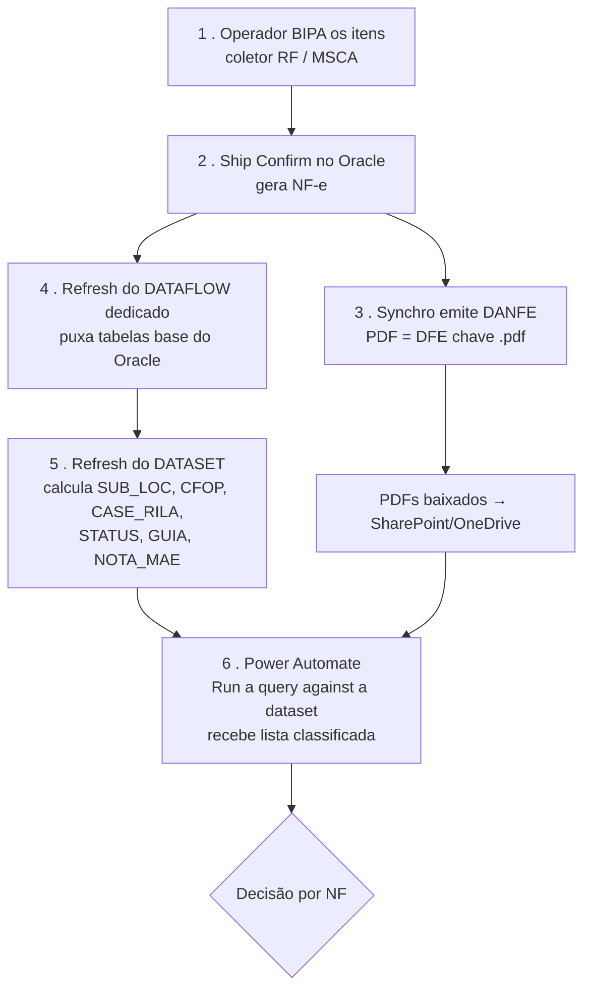

# 📦 Exemplo de Fluxo — Um Prisma com 4 Pedidos

> Referência visual de **ponta a ponta**: do momento em que os itens são bipados até os PDFs chegarem na pasta final, **renomeados e classificados**.
> Baseado nas regras catalogadas em [07_Mapa_de_Regras.md](07_Mapa_de_Regras.md).
> **Última atualização:** 2026-06-23

---

## 🎯 Cenário

Prisma físico `STG.XXXX.045` com **4 pedidos** que tomam **4 destinos diferentes**:

| Pedido | Característica |
|---|---|
| **1** | Nota **mãe** + 1 nota **filha (VIDE)** relacionada — **não** paga guia |
| **2** | Pedido simples que **paga guia** |
| **3** | Pedido que **deu erro** |
| **4** | Pedido simples que **não** paga guia |

---

## 🔄 Etapa comum (todos passam por aqui)



Até aqui os 4 pedidos são **idênticos**: bipados → NF gerada → Synchro gera o PDF → dataset classifica → Power Automate cruza o PDF (pela **chave de acesso**) com a lista. A divergência acontece no nó **"Decisão por NF"**.

---

## 🌳 Árvore de decisão (onde os 4 se separam)

> ⚠️ **Precedência (regra §5 do mapa):** `PAGA_GUIA` é avaliado **antes** da matriz `CASE_RILA × STATUS`. Só quem **não** paga guia chega na matriz.

```mermaid
flowchart TD
    DEC{Decisão por NF} --> PG{PAGA_GUIA?}
    PG -->|SIM| AG[/AGUARDANDO GUIA/<br/>renomeia PAGA GUIA A/B/C/D<br/>+ BANCO DE DADOS PAGA GUIA]
    PG -->|NÃO| RT{CASE_RILA x STATUS}
    RT -->|OK + FINALIZADO| PR[/PRONTO/<br/>imprime + renomeia A/B/C/D<br/>+ registra anti-reimpressão]
    RT -->|STATUS = ERRO| EX[/EXCECAO/ERRO_NF/<br/>não imprime → fiscal]
```

---

## 🚚 O caminho de cada pedido

### 🟦 Pedido 1 — Nota mãe + nota filha (VIDE), não paga guia
1. `GUIA = NÃO PAGA` → segue para a matriz.
2. `NOTA_MAE`: a mãe tem `CT_REFERENCE` nulo; a filha tem **mesma NF+DELIVERY** da linha anterior → vira **VIDE** (célula vazia, **volume 0** para não recontar — regras **M.1 / M.3**).
3. `CASE_RILA = OK` + `STATUS = FINALIZADO` → **IMPRIME**.
4. **M.4** agrupa mãe + filha pelo mesmo DELIVERY/LOCATOR → saem **juntas no mesmo prisma**.
5. **R.1** dá prefixo pela posição (`A1`, `B2`…) → renomeia.
6. **A.3** grava as chaves no controle anti-reimpressão.

> **Destino:** `/PRONTO/` — mãe e filha **agrupadas e renomeadas**, prontas para impressão/expedição.

### 🟩 Pedido 2 — Simples, paga guia
1. `GUIA = PAGA GUIA` → **para aqui** (precedência). **Não vai para a matriz nem imprime.**
2. **R.3** renomeia como `PAGA GUIA A/B/C/D`.
3. Vai para `/AGUARDANDO GUIA/` + acumula em `BANCO DE DADOS - PAGA GUIA` (**G.1**).
4. Na rotina paga-guia (06:30) → zipa e **notifica o Faturamento/GFSS** para gerar/pagar a guia (**G.2** — handoff externo).
5. **Volta (G.5):** quando o Faturamento libera, a chave liberada reentra no fluxo → cai em `OK+FINALIZADO` → imprime → `/PRONTO/`.

> **Destino imediato:** `/AGUARDANDO GUIA/` (renomeado, **mas em espera** — não chega na pasta final até a guia ser liberada).

### 🟥 Pedido 3 — Deu erro
1. `GUIA = NÃO PAGA` → vai para a matriz.
2. `STATUS = ERRO` (status Oracle 1/3/5/7/8 → decode "ERRO", regra **D.9**). Como `STATUS ≠ FINALIZADO`:
   - Se `CASE_RILA = OK` → rótulo **"ERRO NF"**.
   - Se `CASE_RILA ≠ OK` → **"ERRO DELIVERY + ERRO NF"**.
3. **Não imprime.** No AS-IS dispara e-mail fiscal (**E.1**); no TO-BE vai para pasta de exceção.

> **Destino:** `/EXCECAO/ERRO_NF/` (ou e-mail ao fiscal) — **fica fora da pasta de prontos** até alguém corrigir.

### 🟨 Pedido 4 — Simples, não paga guia
1. `GUIA = NÃO PAGA` → matriz.
2. `CASE_RILA = OK` + `STATUS = FINALIZADO` → **IMPRIME**.
3. **R.1** prefixo + renomeia; **A.3** registra anti-reimpressão.

> **Destino:** `/PRONTO/` — renomeado e classificado, caminho mais curto.

---

## 📋 Quadro-resumo

| Pedido | Decisão-chave | Imprime? | Pasta final | Nome do arquivo |
|---|---|---|---|---|
| 1 — mãe + filha | NÃO paga → OK+FINALIZADO + agrupa mãe/filha | ✅ | `/PRONTO/` | `EXPEDICAO A1 - NF <nf> - <data>.pdf` (filha agrupada junto) |
| 2 — paga guia | PAGA GUIA (precede a matriz) | ⏸️ só após liberação | `/AGUARDANDO GUIA/` → depois `/PRONTO/` | `PAGA GUIA A - ...` |
| 3 — erro | STATUS = ERRO | ❌ | `/EXCECAO/ERRO_NF/` | (não renomeia para impressão) |
| 4 — simples | NÃO paga → OK+FINALIZADO | ✅ | `/PRONTO/` | `EXPEDICAO A1 - NF <nf> - <data>.pdf` |

---

## ⚠️ Nuances que este cenário expõe

- **Anti-reimpressão (A.2):** antes de mover qualquer um, o fluxo confere a chave no controle de NFs já expedidas — se já saiu, **pula** (evita reimprimir).
- **O prisma "se divide":** mesmo bipados juntos, os 4 pedidos tomam **4 destinos diferentes**. Só os pedidos 1 e 4 saem juntos para `/PRONTO/`; o 2 fica retido e o 3 vai para exceção.
- **Decisões pendentes do time:** se a exceção vira **pasta** ou **e-mail** (🟡 §5) e se existe sinal no Oracle para a **volta** da paga-guia (⬜ G.5) — ver [07_Open_Questions.md](../03_Analyze/07_Open_Questions.md).

---

## 🔗 Referências

- [07_Mapa_de_Regras.md](07_Mapa_de_Regras.md) — catálogo completo das regras citadas (F, D, C, M, R, A, G, E)
- [01_PowerBI/03_Modelo_Semantico.md](01_PowerBI/03_Modelo_Semantico.md) — modelo semântico e colunas calculadas
- [03_Analyze/07_Open_Questions.md](../03_Analyze/07_Open_Questions.md) — decisões pendentes do time
