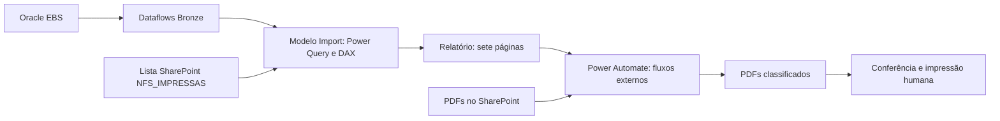

# Manual Técnico - Expedição AFT

Revisão: 2026-10-14. Público: manutenção, suporte e TI. Base: [cópia PBIP atual](../../../Dataset/Modelo_Expedicao.pbip), TMDL e JSON do relatório. Fonte oficial: repositório `mobility-powerbi-architecture`, diretório `reports/EXPEDICAO_AFT/`. Não desenvolver esta cópia e o oficial em paralelo.

## 1. Escopo e evidências

| Componente | Confirmado | Ainda não comprovado |
|---|---|---|
| Power BI | Modelo e relatório locais; funcionamento informado pelo responsável | Ambiente operacional, publicação e homologação |
| Atualizar modelo | Botão `ATUALIZAR DATASET` funcionando | Atualização dos dataflows e espera pelo término |
| Classificar PDFs | Botão `PROCESSAR PDFs` funcionando; classificação no SharePoint conforme Lista de Impressão | Código, filtros, caminhos, retries e tratamento de falhas do fluxo |
| Paga guias | Botão `Paga Guia` funcionando | Entradas, destinatários, resultado e retorno da guia |
| Teste | Visual `PAGA GUIA [TESTE]` presente | Uso operacional autorizado |
| Histórico | `NFS_IMPRESSAS` importada e `STATUS_CICLO` calculado | Momento da gravação, idempotência e comprovação da impressão física |

Os fluxos externos e as definições dos dataflows não foram fornecidos. Presença de código ou visual não comprova execução, pagamento de guia ou paridade integral com a macro.

## 2. Arquitetura

Gateway e credenciais Oracle pertencem à ingestão. O modelo usa `PowerBI.Dataflows(null)` e parâmetro obrigatório `WorkspaceId`. A cópia aponta para `ee6c85f4-c90f-440e-8433-bb036d02ade7`, identificado no handoff histórico como DEV; confirmar ambiente usado pela operação.

Os joins de negócio são feitos em M, principalmente na partição de `NotasFiscais`. Os oito relacionamentos de [relationships.tmdl](../../../Dataset/Modelo_Expedicao_ATUAL.SemanticModel/definition/relationships.tmdl) ligam datas a tabelas automáticas, não as tabelas Oracle entre si.

## 3. Inventário e linhagem

São 33 tabelas: 24 não automáticas, oito `LocalDateTable_*` e um template de data. `NotasFiscais`: 39 colunas, sendo 36 de M e três DAX, e 12 medidas. `NFS_IMPRESSAS`: 42 colunas, incluindo metadados SharePoint.

| Dataflow | Entidades |
|---|---|
| `BRZ_ORACLE_AR_DOC_CUR` | `RA_CUSTOMER_TRX_ALL`, `RA_CUSTOMER_TRX_LINES_ALL` |
| `BRZ_ORACLE_CLL_TXN` | `CLL_F031_ELECTRONIC_TRX_ALL` |
| `BRZ_ORACLE_AR_MST` | `AR_VAT_TAX_ALL_B`, `HZ_CUST_ACCOUNTS`, `HZ_CUST_ACCT_SITES_ALL`, `HZ_CUST_SITE_USES_ALL`, `HZ_LOCATIONS`, `HZ_PARTIES`, `HZ_PARTY_SITES`, `RA_ADDRESSES_ALL`, `RA_BATCH_SOURCES_ALL`, `RA_CUSTOMERS`, `RA_CUST_TRX_TYPES_ALL` |
| `BRZ_ORACLE_INV_MST` | `MTL_ITEM_LOCATIONS`, `MTL_SYSTEM_ITEMS_B` |
| `BRZ_ORACLE_ONT_DOC_CUR` | `OE_ORDER_LINES_ALL` |
| `BRZ_ORACLE_WSH_DOC` | `WSH_DELIVERY_DETAILS`, `WSH_DELIVERY_ASSIGNMENTS`, `WSH_NEW_DELIVERIES` |
| `BRZ_ORACLE_APPLSYS_MST` | `FND_LOOKUP_VALUES`, acesso direto na consulta `NotasFiscais` |

`RA_ADDRESSES_ALL` e `RA_CUSTOMERS` estão carregadas, mas não são usadas na partição atual de `NotasFiscais`. `RA_INTERFACE_LINES_ALL`, `OE_ORDER_HEADERS_ALL` e categorias de itens não estão no inventário atual. Não remover tabelas sem verificar todas as dependências no oficial.

### Recorte WSH

As três consultas usam `BRZ_ORACLE_WSH_DOC`, não `WSH_DOC_CUR`. Corte: data local do refresh menos 45 dias; mantêm `LAST_UPDATE_DATE` não nula e data maior ou igual ao corte, sem limite superior local. Detalhes e entregas filtram `ORGANIZATION_ID = "1627"`; assignments não aplicam esse filtro.

Deduplicação: detalhes por `DELIVERY_DETAIL_ID`; assignments por detalhe + delivery; entregas por `DELIVERY_ID`. Não há ordenação local que garanta selecionar a versão mais recente no WSH. As janelas upstream e os tiers devem ser verificados no orquestrador.

### Histórico SharePoint

`NFS_IMPRESSAS` usa `SharePoint.Tables`, implementação `2.0`, `ViewMode = "All"`, site `https://eaton.sharepoint.com/sites/Expedio-Valinhos` e lista de ID `6829761a-54a9-4496-98f8-acff4f935cf8`. São referências configuradas, não comprovação dos caminhos dos PDFs nem autorização de acesso.

Campos de negócio: `Chave`, `NF`, `DataImpressao`, `Ciclo`, `NomeArquivo`, `PastaDestino`, `CNPJ`, `OrdemClassificacao`, `Cliente`, `UF`, `Delivery`, `NotaMae`, `SubLoc`, `Volume`, `Transp`, `StatusFiscal`, `CaseRila`, `CFOP`, `Apta`, `ICMS_ST`, `FCP_ST`. Confirmar no export dos fluxos quais são gravados. Preservar nomes, tipos, lista e permissões em migrações.

## 4. Pipeline de NotasFiscais

Implementação: [NotasFiscais.tmdl](../../../Dataset/Modelo_Expedicao_ATUAL.SemanticModel/definition/tables/NotasFiscais.tmdl).

1. Cabeçalhos: `ORG_ID = "1344"`, `COMPLETE_FLAG = "Y"`; batch source após trim igual a `VALI AFT VENDA AUTOMATICA` ou `VALI AFT VENDA AUTOMATICA OLD`.
2. CLL: ordenação por `LAST_UPDATE_DATE` descendente, buffer e deduplicação por `CUSTOMER_TRX_ID`.
3. Linhas `TAX`: impostos; linhas `LINE`: quantidades e valores. Locator: AR `INTERFACE_LINE_ATTRIBUTE6` -> WSH `SOURCE_LINE_ID`, apenas `SOURCE_CODE = "OE"` com assignment. Itens e locators juntam por ID mais organização/armazém.
4. Prioridade e embarcado: `OE_ORDER_LINES_ALL`, `ORG_ID = "1344"`. Pedido: linhas AR. Cliente: conta -> party. UF: ship-to site use -> account site -> party site -> location.
5. Exclui tipo `SI COMPL PRECO C/AR` e UF `EX`, preservando nulos nessas verificações. Delivery: `CT_REFERENCE`; volume: `WSH_NEW_DELIVERIES.GLOBAL_ATTRIBUTE3`.
6. Deriva status, guia, aptidão, motivo, mãe/filha; ordena, indexa, nomeia e seleciona 36 colunas finais.

Granularidade pretendida: uma linha por transação fiscal (`CUSTOMER_TRX_ID`), não exposto na saída. `NF` não é chave primária garantida. Testar duplicação de chaves e multiplicação em joins com dados homologados.

Não existe filtro local `TRX_DATE = hoje` nem exclusão geral local de canceladas em `NotasFiscais`. O universo depende do Bronze e dos filtros; canceladas podem aparecer como não aptas.

## 5. Regras implementadas

| Campo | Comportamento |
|---|---|
| `STATUS_FISCAL` | CLL 2 -> FINALIZADO; 4/6 -> CANCELADO; nulo -> SEM_STATUS; demais -> ERRO |
| `CHAVE_LEN` | Comprimento bruto da chave; não valida dígitos ou DV |
| `CASE_RILA` | OK se as duas somas existem e pedido = embarcado; demais VERF_RILA. Igualdade exata, sem tolerância |
| `APTA` | Sim somente com FINALIZADO + OK + comprimento 44; demais Nao |
| `PAGA_GUIA` | AC/AM/AP/RO/RR: SIM; AL/DF/GO/MS/TO: SIM se ICMS-ST não zero; demais NAO |
| `CFOP_ST` | S_ST se ICMS-ST nulo/zero; demais C_ST |
| `CNPJ` | Dígitos de `HZ_PARTIES.JGZZ_FISCAL_CODE`; não garante 14 dígitos/filial |
| `NOTA_MAE` | Menor NF numérica da mesma delivery; filhas recebem referência preenchida para pelo menos sete caracteres. Mãe/isolada: nulo |
| `VOL` | Texto 0 para filha; demais usam volume da delivery |
| `MULTI_LOCATOR` | Sim quando LOC_ALL contém mais de um locator distinto |

ICMS-ST: lookup `XXBR8282_GFSS_TAX_ICMS_ST`, `ENABLED_FLAG = "Y"`, associado a `AR_VAT_TAX_ALL_B.TAX_CODE` e `VAT_TAX_ID`; soma `EXTENDED_AMOUNT` de TAX. FCP-ST usa IDs fixos `16423`, `16424`, `16429`, `16430`, `16435`, `16436`, `16444`, `16445`, `16483`, `16484`; sem linhas pode permanecer nulo. Alterações tributárias exigem Fiscal.

### Prisma, mãe/filha e ordenação

Base de `SUB_LOC`: óleo (CFOP 6.655/5.655) -> `OLEO_` + item; senão GA19 do cabeçalho quando não nulo/não vazio; senão locator `SEG1.SEG2.SEG3`. Acrescenta prioridade reconhecida: UNIDADE PARADA DSH, EMBREAGENS ou DIRECT SHIPMENT. Resultado totalmente em branco vira nulo. Não existe derivação por categoria do sufixo `EMBREAGEM_DSH` no código atual.

Locator agregado prefere status WSH Y/C com locator não nulo, escolhendo o mínimo textual; sem eles, mínimo dos locators disponíveis. Não exige prefixo STG. Locator ausente pode resultar de janela, joins, assignment, origem, organização ou cadastro; não presumir uma causa única.

`SORT_SUBLOC` usa o prisma da mãe quando disponível; não altera o `SUB_LOC` exibido da filha. Sort: `PAGA_GUIA` desc, `SORT_SUBLOC` asc, `CT_REFERENCE` asc, `TRX_NUMBER` asc. Índice inteiro `ORDEM_CLASSIFICACAO` começa em 1 e muda no refresh; filtro visual não renumera. Não assumir sort numérico de NF/delivery textuais.

### Destino, motivo e nome

Precedência de `PASTA_DESTINO`: guia SIM -> `AGUARDANDO GUIA`, mesmo se não apta; apta e óleo -> `OLEO`; apta restante -> `PRONTO`; demais -> `EXCECAO/ERRO_NF`, `EXCECAO/VERIFICAR_DELIVERY`, `EXCECAO/ERRO_DELIVERY_NF`, `EXCECAO/CHAVE_INVALIDA` ou `EXCECAO/OUTROS`.

`MOTIVO`: apta -> OK; comprimento diferente de 44 -> CHAVE INVALIDA; RILA OK e fiscal não finalizado -> ERRO NF; RILA não OK e fiscal finalizado -> VERIFICAR DELIVERY; restante -> ERRO DELIVERY + ERRO NF. CHAVE INVALIDA descreve o campo do modelo, não uma leitura do PDF.

Nome: guia -> `PAGA GUIA <L><pos> - NF <nf>.pdf`; apta restante -> `EXPEDICAO <L><pos> - NF <nf>.pdf`; demais -> `DFE<chave>.pdf`. A: posição <10; B: <100; C: <1000; D: demais. D não garante ordenação lexical numérica correta com cinco ou mais dígitos. A ordem física de impressão depende do leitor PDF/spooler; validar na estação.

### DAX e datas

- `DL_CMD`: constante `*DN`; confirmar uso no sistema de etiquetas.
- `CHAVE_44`: trim e remoção de prefixo DFE inicial; não valida dígitos/DV nem altera `CHAVE_LEN` de M.
- `STATUS_CICLO`: comprimento normalizado diferente de 44 -> SEM CHAVE; chave em histórico importado -> JA PROCESSADA; restante -> PENDENTE. A chave do histórico não é normalizada pela fórmula. Só muda no refresh, não consulta a lista ao vivo.
- `ChavesParaCopiar`/`QtdChaves`: chaves brutas/contagem de linhas aptas com comprimento 44; sem DISTINCT e sem excluir JA PROCESSADA por si só. Conferir filtros antes de baixar novamente.
- `Atualizacao.UltimaAtualizacao`: texto gerado no refresh em UTC-3; não prova término dos dataflows ou fluxos.
- `DATA_HORA_FAT`: interpreta CREATION_DATE como UTC-5 e converte para UTC-3, removendo o fuso; falha vira nulo. Validar essa premissa com a origem.

## 6. Relatório e indicadores

| Página | Conteúdo |
|---|---|
| Visão Geral | Cinco cartões, destinos/motivos e filtro DATA_HORA_FAT |
| Lista de Impressão | Ordem, guia, NF, delivery, mãe, prisma, volume, cliente, UF, transporte, aptidão, chave, impostos e status; filtros de data, aptidão e guia; quatro visuais de fluxo |
| Monitor | Motivo, NF, delivery, fiscal, RILA, comprimento da chave e prisma |
| Óleo | Guia, NF, delivery, prisma, volume, cliente, UF, transporte e chave |
| Chaves para Download | Medida de chaves, quantidade e filtro de data |
| DL Etiquetas | Ordem/NF/chave/prisma/aptidão; ordem/chave/*DN; filtros de NF, data e prisma |
| Mesma NF em Outro Locator | Visual baseado em NotasFiscais/LOC_ALL; não na tabela auxiliar vazia MesmaNF_OutroLocator |

Medidas: `ChavesParaCopiar`, `QtdChaves`, `DIAG_TotalLinhas`, `DIAG_Aptas`, `Total do Ciclo`, `Qtd Prontos`, `Qtd Paga Guia`, `Qtd Oleo`, `Qtd Excecoes`, `DIAG_Pronto_SubLocNulo`, `DIAG_Pronto_PrioridadeSozinha`, `DIAG_Pronto_ComPrisma`.

`Qtd Excecoes` conta APTA Nao, não destinos EXCECAO. Pode sobrepor Qtd Paga Guia. Não somar os quatro cartões de categoria como reconciliação garantida. Diagnóstico ComPrisma é heurística de subtração, não validação de localização física.

O nome de uma aba não garante filtro de todas as linhas. Revisar filtros de visual, página e usuário no JSON/Service. Os três visuais de processamento/guia não têm campos de consulta no JSON; exportar os fluxos para confirmar seu universo. Não assumir que a seleção do relatório limita o processamento.

## 7. Runbook de suporte

| Sintoma | Investigar | Responsável por papel |
|---|---|---|
| NF ausente | Filtros, batch source, COMPLETE_FLAG, janela e refresh Bronze | Dados/BI |
| Prisma ausente/prioridade isolada | GA19, AR -> WSH, assignments, janela 45 dias, organização, MTL, horários | Dados + Expedição |
| Delivery divergente | Somas AR/OE, duplicação nos joins, defasagem | Armazém + Dados |
| Guia inesperada | UF ship-to, lookup e ICMS-ST | Fiscal + Dados |
| Histórico atrasado | Lista real, chave e refresh do modelo | TI/Automação |
| Movimento parcial de PDFs | Histórico do fluxo, origem/destino, conexões, concorrência | Automação |
| Botão falha | Permissão, proprietário, ambiente, conexões e execução | Automação |

Registrar horário, ciclo, filtros, versão, ID de execução, erro, arquivos de origem/destino e chaves em canal restrito. Suspender novos disparos na falha parcial; reconciliar antes de repetir. Mover arquivo ou gravar histórico não prova impressão física. Não apagar histórico para forçar reimpressão.

## 8. Manutenção, publicação e retorno

1. Localizar artefato oficial; registrar commit, ambiente, proprietários, conexões e backups de PBIP/fluxos/configuração SharePoint.
2. Trabalhar em DEV. Mudança em dataflow compartilhado exige dono. Alteração fiscal exige Fiscal. Não promover esta cópia sem comparação com o oficial.
3. Validar origem primeiro; atualizar dataflows, aguardar sucesso, depois modelo e visuais. Botão de modelo não comprova encadeamento completo.
4. Comparar amostra homologada com query/macro e registrar diferenças aceitas. Testar filtros, cardinalidade, classificação, nomes, guia, histórico, concorrência e falha parcial.
5. Obter aceite Expedição/Fiscal/TI. Publicar pelo processo corporativo confirmado; conferir WorkspaceId, rebind, fluxos, SharePoint, conexões e acesso.
6. Em regressão, suspender disparos, restaurar versão homologada e reconciliar os efeitos externos. Restaurar PBIP não desfaz movimento de arquivos nem histórico SharePoint.

Licenças, limites de refresh/API, capacidade, DLP, gateway e permissões de consulta/Build precisam de validação no tenant. A antiga premissa Power Automate Free não é garantia de licenciamento. Horários, SLAs e contatos: a confirmar.

## 9. Aceite mínimo

Testar: apta normal/óleo; fiscal 4/6/nulo; RILA divergente; UF incondicional sem imposto; UF condicional com/sem imposto; guia com nota não apta; mãe/filha; múltiplos locators; chave no histórico; prefixo DFE e 44 caracteres não numéricos; filtro visual versus fluxo; falha parcial/duplo clique; reimpressão autorizada do lote afetado. Registrar entrada, expectativa, resultado, versão e aprovador por caso.

A revisão foi estática. Não executou Desktop/Service, Oracle, SharePoint ou Power Automate, nem comprovou cardinalidade ou paridade com dados reais.

## Referências

- [Dicionário das 39 colunas](../04_Improve/01_PowerBI/01_Dataset_Schema.md).
- [Mapa de regras e diferenças do legado](../04_Improve/07_Mapa_de_Regras.md).
- [Manual da expedição](../05_Control/05_Manual_Operador.md).
- [Pendências de homologação](../03_Analyze/07_Open_Questions.md).
- [Handoff de TI](../04_Improve/05_Implementacao/HANDOFF.md).
