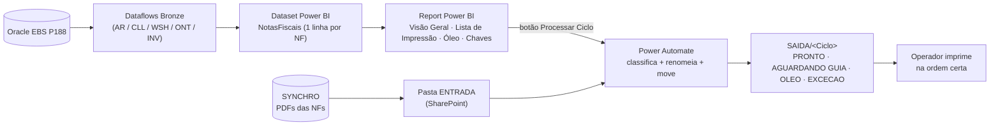

# Documentação da Ferramenta - Expedição AFT

> **Revisão vigente: 2026-10-14.** Pacote em Markdown para treinamento e transferência técnica. A liberação operacional ainda depende das pendências de homologação.

## Entrega por público

| Documento | Público | Conteúdo |
|---|---|---|
| [Guia rápido](02_Modo_de_Uso_Operador.md) | Operador | Conferir rodada, atualizar modelo, processar PDFs, segregar pendências e imprimir |
| [Manual completo](../05_Control/05_Manual_Operador.md) | Expedição | Telas, botões, passos, exceções, impressão, histórico, reimpressão e contatos a confirmar |
| [Manual técnico](01_Documentacao_Tecnica.md) | TI/BI/Automação | Linhagem, regras M/DAX, limites, suporte, publicação, rollback e testes |
| [Dicionário](../04_Improve/01_PowerBI/01_Dataset_Schema.md) | Integração/manutenção | Contrato das 39 colunas de NotasFiscais |
| [Handoff](../04_Improve/05_Implementacao/HANDOFF.md) | TI que assume a ferramenta | Artefatos, acessos, evidências e primeira manutenção |
| [Plano de controle](../05_Control/01_Plano_de_Controle.md) | Supervisor | Reconciliação, acompanhamento e responsabilidade por papel |
| [Pendências P01-P19](../03_Analyze/07_Open_Questions.md) | Aprovadores | O que falta para homologar e entregar a rotina |

## Base da revisão

Arquivos da [cópia atual do Power BI](../../../Dataset/README.md), documentação DMAIC, queries e referências textuais do legado. Confirmação do responsável: Power BI, atualização do modelo, paga guias e classificação de PDFs em SharePoint conforme Lista de Impressão funcionam. Código dos fluxos, configuração upstream e execuções reais não foram auditados nesta revisão.

O orquestrador `mobility-powerbi-architecture` continua como fonte oficial do PBIP. Não há link local para esse outro repositório nesta cópia. Não tratar estudos, exemplos, prompts de construção ou roteiro offline como implementação atual.

## Pendências antes da entrega operacional

Preencher ambiente/link, caminhos, contatos, SLA, rotina de guia e download; homologar filtros versus universo do fluxo, duplicidade, falha parcial, impressão e recuperação. Obter aprovação de Expedição, Fiscal e TI. Os campos “a confirmar” são lacunas explícitas, não configurações padrão sugeridas.

## Versões e manutenção

Markdown é a entrega vigente. PDFs antigos desta pasta não foram atualizados e não devem acompanhar a entrega como se fossem desta revisão. Exportar PDF futuramente apenas após aprovação, conferindo tabelas, links, quebras e diagramas no arquivo final; nenhuma ferramenta de export foi validada aqui.

Atualizar dicionário/regras quando mudar TMDL; manual quando mudar tela, botão ou procedimento; handoff quando mudar ambiente, fluxo, conexão ou responsável. Preservar histórico de medições e decisões, sem reapresentá-lo como resultado atual. Aprovação documental: a confirmar.

Índice de agosto/2026: histórico, não pacote vigente

> Automação da **classificação e ordenação de Notas Fiscais** da Expedição (Eaton Valinhos / Aftermarket), substituindo a macro VBA legada por **Power BI + Power Automate**.
> **Última atualização:** 2026-08-31

Este é o **ponto de entrada** da documentação da ferramenta. Cada público tem seu guia.

---

## O que é a ferramenta (em uma frase)

A partir das NFs faturadas no Oracle EBS, a ferramenta **classifica cada nota** (destino físico / prisma), define a **ordem de impressão** e **organiza os PDFs em pastas** prontos para o operador imprimir — sem separação manual.

## Arquitetura (visão de 1 minuto)

## Índice da documentação

| # | Documento | Público | Status |
|---|---|---|---|
| — | [02_Modo_de_Uso_Operador.md](02_Modo_de_Uso_Operador.md) | Operador (chão) — **como rodar o fluxo** | ✅ |
| — | [01_Documentacao_Tecnica.md](01_Documentacao_Tecnica.md) | Técnico / manutenção | 🚧 em construção |
| — | [Manual do Operador (completo)](../05_Control/05_Manual_Operador.md) | Operador (chão) | ✅ existente |
| — | [Relatório da Solução em 3 Estágios](../04_Improve/11_Relatorio_Estagios.md) | Gestão / visão geral | ✅ existente |
| — | HANDOFF externo no repositório mobility-powerbi-architecture, em reports/EXPEDICAO_AFT/HANDOFF.md; não disponível nesta cópia | Técnico (no repo do orquestrador) | Referência histórica |

> **A construir:** Guia do Supervisor/Gestor (KPIs) e Operação & Manutenção (refresh, limpeza de pastas). Ver seção "Próximos" no fim.

## Componentes da solução

| Camada | O que faz | Onde |
|---|---|---|
| **Oracle EBS** | Fonte dos dados (NFs, entregas, pedidos, itens) | Servidor `P188` |
| **Dataflows Bronze** | Ingestão das tabelas Oracle | Workspace de dataflows (compartilhado) |
| **Dataset `NotasFiscais`** | Classifica cada NF (1 linha/NF): destino, ordem, apta/exceção | Power BI (workspace DEV/PROD) |
| **Report Power BI** | Visão Geral (KPIs), Lista de Impressão, Óleo, Chaves + botões | Power BI |
| **Power Automate** | Fluxo "Processar Ciclo": casa PDF↔NF por chave, renomeia, move | Ambiente Power Automate |
| **SharePoint** | Pastas ENTRADA / SAIDA/\<Ciclo\> + lista anti-reimpressão | SharePoint "Expedição - Valinhos" |

---

## Como gerar PDF a partir deste Markdown

1. **VS Code (recomendado):** instale a extensão **"Markdown PDF"** → botão direito no `.md` → **Markdown PDF: Export (pdf)**.
2. **Sem extensão:** abra o Preview (`Ctrl+Shift+V`) → não imprime direto; use a extensão acima ou copie pro Word.
3. **Pandoc (se disponível):** `pandoc arquivo.md -o arquivo.pdf`.

> Os diagramas `mermaid` renderizam no **GitHub** e no **Preview do VS Code**. Para o PDF sair com o diagrama, use a extensão "Markdown PDF" (ela renderiza mermaid).

---

## Próximos (a escrever)
- [ ] `02_Guia_Supervisor.md` — KPIs da Visão Geral, o que monitorar, quando escalar.
- [ ] `03_Operacao_e_Manutencao.md` — refresh dos dataflows, `DaysText`, limpeza de pastas SAIDA, troubleshooting.
- [ ] `04_Governanca.md` — DEV/PROD, dataflows compartilhados, decisões do dono.
- [ ] Mover/consolidar o Manual do Operador para cá (hoje em `05_Control`).

