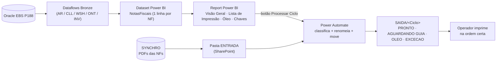

# 📦 Ferramenta de Expedição AFT — Documentação

> Automação da **classificação e ordenação de Notas Fiscais** da Expedição (Eaton Valinhos / Aftermarket), substituindo a macro VBA legada por **Power BI + Power Automate**.
> **Última atualização:** 2026-08-31

Este é o **ponto de entrada** da documentação da ferramenta. Cada público tem seu guia.

---

## O que é a ferramenta (em uma frase)

A partir das NFs faturadas no Oracle EBS, a ferramenta **classifica cada nota** (destino físico / prisma), define a **ordem de impressão** e **organiza os PDFs em pastas** prontos para o operador imprimir — sem separação manual.

## Arquitetura (visão de 1 minuto)

## Índice da documentação

| # | Documento | Público | Status |
|---|---|---|---|
| — | [02_Modo_de_Uso_Operador.md](02_Modo_de_Uso_Operador.md) | Operador (chão) — **como rodar o fluxo** | ✅ |
| — | [01_Documentacao_Tecnica.md](01_Documentacao_Tecnica.md) | Técnico / manutenção | 🚧 em construção |
| — | [Manual do Operador (completo)](../05_Control/05_Manual_Operador.md) | Operador (chão) | ✅ existente |
| — | [Relatório da Solução em 3 Estágios](../04_Improve/11_Relatorio_Estagios.md) | Gestão / visão geral | ✅ existente |
| — | [HANDOFF técnico do modelo](../../../mobility-powerbi-architecture-codespace-literate-pancake-r7gjv6qjq5rq2r6v/reports/EXPEDICAO_AFT/HANDOFF.md) | Técnico (no repo do orquestrador) | ✅ existente |

> **A construir:** Guia do Supervisor/Gestor (KPIs) e Operação & Manutenção (refresh, limpeza de pastas). Ver seção "Próximos" no fim.

## Componentes da solução

| Camada | O que faz | Onde |
|---|---|---|
| **Oracle EBS** | Fonte dos dados (NFs, entregas, pedidos, itens) | Servidor `P188` |
| **Dataflows Bronze** | Ingestão das tabelas Oracle | Workspace de dataflows (compartilhado) |
| **Dataset `NotasFiscais`** | Classifica cada NF (1 linha/NF): destino, ordem, apta/exceção | Power BI (workspace DEV/PROD) |
| **Report Power BI** | Visão Geral (KPIs), Lista de Impressão, Óleo, Chaves + botões | Power BI |
| **Power Automate** | Fluxo "Processar Ciclo": casa PDF↔NF por chave, renomeia, move | Ambiente Power Automate |
| **SharePoint** | Pastas ENTRADA / SAIDA/\<Ciclo\> + lista anti-reimpressão | SharePoint "Expedição - Valinhos" |

---

## Como gerar PDF a partir deste Markdown

1. **VS Code (recomendado):** instale a extensão **"Markdown PDF"** → botão direito no `.md` → **Markdown PDF: Export (pdf)**.
2. **Sem extensão:** abra o Preview (`Ctrl+Shift+V`) → não imprime direto; use a extensão acima ou copie pro Word.
3. **Pandoc (se disponível):** `pandoc arquivo.md -o arquivo.pdf`.

> Os diagramas `mermaid` renderizam no **GitHub** e no **Preview do VS Code**. Para o PDF sair com o diagrama, use a extensão "Markdown PDF" (ela renderiza mermaid).

---

## Próximos (a escrever)
- [ ] `02_Guia_Supervisor.md` — KPIs da Visão Geral, o que monitorar, quando escalar.
- [ ] `03_Operacao_e_Manutencao.md` — refresh dos dataflows, `DaysText`, limpeza de pastas SAIDA, troubleshooting.
- [ ] `04_Governanca.md` — DEV/PROD, dataflows compartilhados, decisões do dono.
- [ ] Mover/consolidar o Manual do Operador para cá (hoje em `05_Control`).
